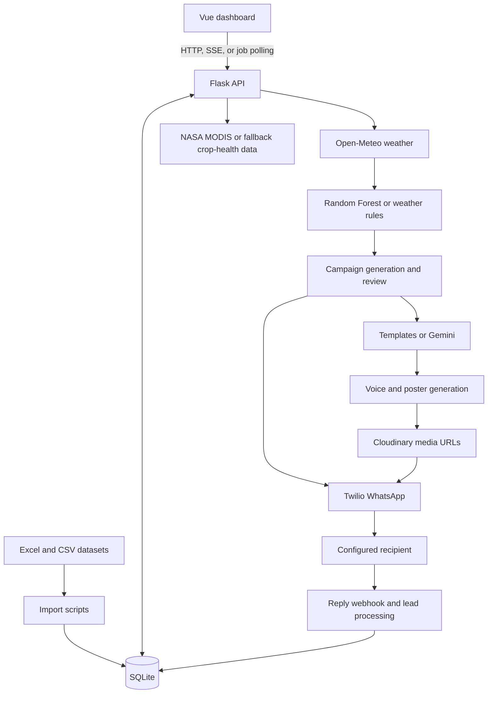

# KrishiConnect AI — Syngenta Hackathon

A crop advisory and campaign management prototype that connects district-level weather and crop data with disease-risk prediction, multilingual advisory content, retailer inventory, and farmer feedback.

The application combines a Vue dashboard with a Flask backend. It can import the supplied agricultural datasets, train a Random Forest classifier, generate district-level campaign records, and deliver configured WhatsApp demonstrations through Twilio. Crop-health maps use satellite data when available, with explicitly different weather-derived and simulated fallback modes.

## Contents

- [Capabilities](#capabilities)
- [Architecture](#architecture)
- [Technology stack](#technology-stack)
- [Repository structure](#repository-structure)
- [Local setup](#local-setup)
- [Configuration](#configuration)
- [Accounts and demo workflow](#accounts-and-demo-workflow)
- [Datasets and database](#datasets-and-database)
- [Prediction and fallback behavior](#prediction-and-fallback-behavior)
- [API overview](#api-overview)
- [Deployment](#deployment)
- [Verification and troubleshooting](#verification-and-troubleshooting)
- [Current limitations](#current-limitations)

## Capabilities

| Area | Implemented behavior |
| --- | --- |
| District and crop exploration | Filter district data by state, season, and crop; inspect crop coverage and dashboard totals. |
| Weather | Fetch seven-day forecasts from Open-Meteo and cache district weather in SQLite. |
| Disease risk | Use a trained classifier where supported, with weather-based rule fallback; attach disease/product mappings. |
| Campaigns | Generate advisory records, inspect progress, review campaigns, approve them, and request delivery. |
| Advisory content | Generate text, voice scripts, and poster copy using templates and optional Gemini integration. |
| Media and WhatsApp | Generate voice audio and poster images, upload media to Cloudinary, and send to configured test recipients through Twilio. |
| Crop-health map | Match coordinates to nearby districts and classify crop stress using NASA MODIS, weather-derived estimates, or demo data. |
| Inventory | Compare estimated demand with retailer stock, identify supply gaps, and summarize channel routing. |
| Feedback and leads | Process farmer replies, classify interest or field issues, score leads, and expose engagement/outbreak views. |
| User management | Employee registration, pending approval, login, and administrator user-management screens. |

The frontend routes are `/`, `/overview`, `/campaigns`, `/ndvi`, `/inventory`, `/channels`, `/admin`, `/login`, and `/register`.

## Architecture



Long-running pipeline jobs use Python threads and in-process job state. Development can stream progress through Server-Sent Events; the deployed frontend uses polling to handle proxy timeouts. This project does not use Celery or Redis.

## Technology stack

| Layer | Technology |
| --- | --- |
| Frontend | Vue 3, Vue Router 4, Vite 8, Axios, Leaflet |
| Backend | Flask, Flask-CORS, Python `sqlite3`, `python-dotenv` |
| Data and ML | pandas, NumPy, openpyxl, scikit-learn `RandomForestClassifier` |
| Advisory generation | `google-generativeai`, template fallback |
| Voice and images | Edge TTS, gTTS fallback in the media service, Pillow |
| External services | Open-Meteo, NASA MODIS, Twilio WhatsApp, Cloudinary |
| Hosting configuration | Render/Gunicorn backend, Vercel frontend |

See [backend/requirements.txt](backend/requirements.txt) and [frontend/package.json](frontend/package.json) for dependency declarations.

## Repository structure

```text
Syngenta_hackathon_/
|-- backend/
|   |-- app.py                  # API registration, data queries, dashboard, startup
|   |-- config.py               # Service configuration and runtime paths
|   |-- database.py             # SQLite schema and migration helpers
|   |-- import_data.py          # District/crop and disease/product Excel import
|   |-- import_syngenta.py      # Retailer, inventory, POS, and grower CSV import
|   |-- train_model.py          # Random Forest training and model serialization
|   |-- init_users.py           # Legacy demo-user initialization helper
|   |-- reset_db.py             # Database maintenance helper
|   |-- routes/                 # Weather, campaigns, auth, inventory, NDVI, feedback
|   |-- services/               # Prediction, content, media, delivery, analytics
|   |-- .env.example
|   |-- render-build.sh
|   `-- gunicorn.conf.py
|-- frontend/
|   |-- src/views/              # Dashboard and workflow pages
|   |-- src/config/api.js       # API base URL normalization
|   |-- src/store/pipelineStore.js
|   |-- src/router/index.js
|   |-- .env.example
|   `-- vercel.json             # SPA route fallback
|-- syngenta/                   # Supplied CSV datasets
|-- Book1_final.xlsx
|-- disease_product_mapping.xlsx
|-- ml_training_data_clean.xlsx
`-- render.yaml
```

Generated files include `backend/krishiconnect.db`, `backend/models/disease_model.pkl`, `backend/static/audio/`, and `backend/static/posters/`. The root `.gitignore` excludes these runtime artifacts and local environment files.

## Local setup

### 1. Prerequisites and environment

- Python 3.11 or 3.12 is a recommended starting environment; backend dependencies use minimum versions rather than a lock file.
- Node.js 20.19+ on the 20.x line, or 22.12+ on a newer line, for Vite 8.
- Git and npm.
- Internet access for package installation and live weather, satellite, voice, and messaging integrations.

```bash
git clone https://github.com/23f3002149/Syngenta_hackathon_.git
cd Syngenta_hackathon_
python -m venv .venv
```

Activate in PowerShell:

```powershell
.\.venv\Scripts\Activate.ps1
```

Or on macOS/Linux:

```bash
source .venv/bin/activate
```

Install dependencies:

```bash
python -m pip install -r backend/requirements.txt
cd backend
```

### 2. Configure the backend

Create a local `.env` from `backend/.env.example`. From `backend/`, in PowerShell:

```powershell
Copy-Item .env.example .env
```

Or on macOS/Linux:

```bash
cp .env.example .env
```

For initial exploration, leave Gemini, Twilio, and Cloudinary credentials blank. Dataset browsing and rule/template paths can be explored without these credentials; live weather still needs network access, and WhatsApp/media delivery requires the corresponding services.

### 3. Import data and train the model

From `backend/`, run these in order on a fresh local database:

```bash
python import_data.py
python import_syngenta.py
python -c "from database import migrate_db; migrate_db()"
python train_model.py
```

- `import_data.py` initializes the core schema and imports the two reference workbooks.
- `import_syngenta.py` creates and populates the retailer/grower/inventory/POS tables and SKU mapping.
- `migrate_db()` adds the feedback and delivery columns used by newer routes.
- `train_model.py` reads the training workbook and writes `models/disease_model.pkl`.

Training prints the measured holdout accuracy and classification report. No fixed accuracy figure is claimed here. Run training before starting the backend so the service can load the model at import time.

The full repository checkout is required: the import/training scripts resolve data files from the parent of `backend/`.

### 4. Start the backend

```bash
python app.py
```

The API runs on `http://localhost:5000`. Check `http://localhost:5000/api/health`; after successful imports its district, disease-mapping, and crop-entry counts should be nonzero.

Starting the app on its own can initialize an empty database, but it does not import all the supplied data or train the model.

### 5. Start the frontend

In a second terminal, from the repository root:

```bash
cd frontend
npm ci
npm run dev
```

Open the Vite URL, normally `http://localhost:5173`.

For local development, the frontend already defaults to `http://localhost:5000/api`. If you create `frontend/.env`, use:

```dotenv
VITE_API_URL=http://localhost:5000
```

The example file contains a hosted-backend placeholder, so replace it before using it locally. Restart Vite after changing environment values.

## Configuration

| Variable | Purpose and current behavior |
| --- | --- |
| `GEMINI_API_KEY` | Optional single Gemini key. Without a key, content generation uses templates. |
| `GEMINI_API_KEYS` | Optional comma-separated keys read by the content service. |
| `TWILIO_ACCOUNTS` | Account entries formatted as `SID:TOKEN:SANDBOX_JOIN_CODE`, separated by commas. The current delivery service initializes clients from this list. |
| `TWILIO_ACCOUNT_SID`, `TWILIO_AUTH_TOKEN` | Legacy fields parsed by configuration; setting only these does not populate the current delivery service's account list. |
| `TWILIO_WHATSAPP_NUMBER` | Sender address; defaults to the Twilio sandbox sender in configuration. |
| `TEST_NUMBERS` | Comma-separated demonstration recipient numbers. The current send implementation formats recipients with India's `+91` country code. |
| `DEMO_RETAILER_NUMBER` | Optional recipient for retailer-notification demonstrations. |
| `CLOUDINARY_CLOUD_NAME`, `CLOUDINARY_API_KEY`, `CLOUDINARY_API_SECRET` | Credentials for publishing generated media at URLs Twilio can fetch. |
| `PIPELINE_CACHE_HOURS` | Parsed by configuration with a default of `24`; the current pipeline does not reference this setting. |
| `VITE_API_URL` | Frontend API server root. `src/config/api.js` appends `/api` if needed. This value is embedded at build time. |
| `VITE_USE_PIPELINE_POLLING` | Set to `true` to force polling during local frontend testing. Production builds already prefer polling. |
| `PORT` | Gunicorn bind port, defaulting to `10000`; the direct development script uses `5000`. |

The database path is defined in `backend/config.py`, not taken from a `DATABASE_URL` variable. Keep service credentials in local environment files or hosting settings.

## Accounts and demo workflow

The database initializer seeds a hardcoded demo administrator. The seed is defined in [backend/database.py](backend/database.py); replace that demo account before exposing a deployment.

For an account you control, register at `/register`, then promote that account in the **local** `backend/krishiconnect.db` using a SQLite editor:

```sql
UPDATE users
SET role = 'admin', status = 'approved'
WHERE email = 'your-registered-email@example.com';
```

The registration flow creates pending employees. After signing in as an administrator, use `/admin` to approve or reject other registrations. Login checks password and approval status; frontend routing uses the returned user object in local storage.

A useful exploration sequence is:

1. Verify imported counts through `/api/health`.
2. Sign in and inspect the dashboard, crop overview, inventory, and channel routing pages.
3. Run a pipeline for a state, inspect district progress, and review the resulting campaigns.
4. Inspect crop-health map records and their data-source/fallback indicators.
5. Review campaign text before enabling delivery.
6. For an intentional messaging demo, configure Twilio test recipients and their sandbox membership, plus Cloudinary for media.
7. Point the Twilio incoming-message webhook to your publicly reachable `/api/webhook/twilio` endpoint and inspect processed replies through the leads/engagement APIs.

Approval requests with `send_now: true` perform delivery, and several frontend approval buttons use that flag. Leave delivery credentials/recipients unset while exploring without sending messages.

## Datasets and database

| Source | Consumer and purpose |
| --- | --- |
| `Book1_final.xlsx` | `import_data.py`: district, state, crop, season, language, and coordinate reference data. |
| `disease_product_mapping.xlsx` | `import_data.py`: disease-to-product, dosage, and application reference mapping. |
| `ml_training_data_clean.xlsx` | `train_model.py`: supervised classification training data. |
| `syngenta/retailers.csv` | `import_syngenta.py`: retailer locations and territory identifiers. |
| `syngenta/retailer_inventory_weekly.csv` | `import_syngenta.py`: retailer stock snapshots. |
| `syngenta/retailer_pos.csv` | `import_syngenta.py`: retailer sales records. |
| `syngenta/growers.csv` | `import_syngenta.py`: grower profiles used in reach and demand estimates. |
| Other CSVs in `syngenta/` | Supplied digital-funnel, territory-representative, visit-log, and campaign data; the current importer does not load these files. |

Core tables cover `districts`, `district_crops`, `disease_product_map`, `weather_cache`, `predictions`, `campaigns`, `delivery_log`, `farmer_feedback`, `ab_tests`, `ndvi_alerts`, `settings`, and `users`.

The network import adds `sku_product_map`, `syngenta_retailers`, `syngenta_inventory`, `syngenta_pos`, and `syngenta_growers`. Predictions and campaigns reference districts; feedback and delivery records connect the outbound campaign flow with subsequent responses.

An `ab_tests` table and content-variant helpers exist, but the presence of those structures does not establish a complete experiment assignment and evaluation workflow.

## Prediction and fallback behavior

### Disease model

Training uses an 80/20 stratified split with `random_state=42`. The Random Forest has 150 estimators, maximum depth 12, minimum split size 5, and minimum leaf size 2.

Its eleven inputs are encoded crop, disease, season, and region; month; average temperature; humidity; rainfall; soil moisture; wind speed; and consecutive wet days. At inference, some inputs are estimated from available weather and district context.

The classifier estimates the probability of disease for candidate crop/disease combinations. The ML path retains probabilities above `0.2` and labels them `ADVISORY`, `MODERATE` at `0.45+`, or `HIGH` at `0.7+`. Missing/unloadable models and unsupported crops use weather rules instead. Predictions are advisory outputs from the supplied data/model, not a validated field diagnosis.

### Weather, content, and map data

- **Weather:** seven-day Open-Meteo forecasts are cached for six hours.
- **Content:** template generation is available without Gemini. The batch pipeline explicitly uses fast template-cache generation; Gemini support does not mean every campaign calls a language model.
- **Voice:** the delivery media service attempts Edge TTS, then gTTS. Voice synthesis still requires network access.
- **Posters:** Pillow creates local images; Cloudinary supplies public media URLs for delivery. Missing fonts can affect regional-script rendering.
- **Crop-health map:** the service attempts NASA MODIS NDVI, then a weather-derived vegetation-health estimate, then deterministic demo values. The fallback values are not satellite measurements.
- **Campaign duplication:** existing campaigns for the same district and disease suppress another campaign for that combination. Changing hourly cooldown fields is not equivalent to clearing this deduplication.
- **Inventory demand:** demand is a heuristic based on grower count, severity, and assumed units per farmer, compared with supplied stock snapshots.

Farmer replies map `1` to more information, `2` to expert help, `3` to purchase interest, and `4` to a field issue. Lead scores and priorities are rule-based in [feedback_service.py](backend/services/feedback_service.py).

## API overview

All application endpoints below use the `/api` prefix. This is a selected route map; see [backend/routes/](backend/routes/) and [backend/app.py](backend/app.py) for payload details.

| Area | Main endpoints |
| --- | --- |
| Health and reference data | `GET /api/health`, `/api/states`, `/api/crops`, `/api/districts`, `/api/districts/<district_id>/crops`, `/api/diseases` |
| Accounts | `POST /api/auth/register`, `POST /api/auth/login` |
| User management | `GET /api/admin/users`; `POST /api/admin/users/<user_id>/approve` or `/reject`; `DELETE /api/admin/users/<user_id>` |
| Weather | `GET /api/weather/<district_id>`, `POST /api/weather/batch` |
| Predictions | `GET /api/predict/<district_id>`, `POST /api/predict/batch` |
| Pipeline | `POST /api/campaign/run`, `POST /api/campaign/start-async`, `GET /api/campaign/job/<job_id>`, `GET /api/campaign/stream` |
| Campaign review | `GET /api/campaign/list`, `GET /api/campaign/<campaign_id>`, `POST /api/campaign/approve` |
| Delivery | `POST /api/delivery/test`, `/api/delivery/campaign/<campaign_id>`, `/api/delivery/broadcast`; `GET /api/delivery/stats` |
| Crop health | `POST /api/ndvi/scan`; `GET /api/ndvi/alerts`, `/api/ndvi/heatmap`, `/api/overview/health` |
| Inventory | `GET /api/inventory/overview`, `/api/inventory/supply-alerts`, `/api/inventory/channel-routing`; `POST /api/inventory/notify-retailer` |
| Replies and leads | `POST /api/webhook/twilio`, `POST /api/webhook/simulate`, `GET /api/leads`, `PUT /api/leads/<feedback_id>/status` |
| Analytics/settings | `GET /api/dashboard/stats`, `/api/engagement`, `/api/engagement/ground-truth`, `/api/engagement/outbreaks`; `GET/POST /api/settings` |

For a small pipeline run, `POST /api/campaign/start-async` accepts JSON such as `{"state":"Maharashtra","season":"Kharif","limit":5}`. Poll the returned job ID at `/api/campaign/job/<job_id>?since=0`; subsequent `since` values represent the number of events already received. Pipeline generation writes local prediction/campaign records.

## Deployment

### Backend on Render

[render.yaml](render.yaml) specifies the `backend/` root, `bash render-build.sh` build command, and `gunicorn app:app -c gunicorn.conf.py` start command.

The build script installs requirements, imports reference/network data, and trains the model. The Gunicorn configuration uses one worker, four threads, a 300-second timeout, and the hosting `PORT` value.

The supplied build script does not invoke `migrate_db()`, and Gunicorn does not execute the `if __name__ == '__main__'` startup section. Include the migration step in the deployment build workflow before serving newer feedback/delivery routes:

```bash
bash render-build.sh
python -c "from database import migrate_db; migrate_db()"
```

Ensure the full repository datasets remain available to the backend build. SQLite and generated local files need persistent storage if records must survive a redeploy; no persistent disk is configured in the supplied blueprint.

### Frontend on Vercel

Use `frontend/` as the project root, `npm run build` as the build command, and `dist` as the output directory. Configure `VITE_API_URL` to the public backend root **before** building.

[frontend/vercel.json](frontend/vercel.json) rewrites browser routes to the SPA entry point. The frontend API URL is a build-time value, so rebuild after changing it.

For a local build check:

```bash
cd frontend
npm run build
npm run preview
```

## Verification and troubleshooting

No automated test suite is currently included. Manual verification can cover health counts, login/approval, a small pipeline run, campaign review, data-source labels on the map, inventory views, and frontend production compilation. Messaging and media checks require intentionally configured external services.

| Symptom | What to check |
| --- | --- |
| Empty dashboard or `no such table` | Complete both data imports; apply `migrate_db()` for newer delivery/feedback fields. |
| ML model not found | Run `python train_model.py` in `backend/`, then restart the API. Rules are used without a loadable model. |
| Missing spreadsheet/CSV | Keep the full repository directory structure; the scripts read parent-directory datasets. |
| Frontend points to a placeholder host | Set `VITE_API_URL` correctly and restart Vite or rebuild the deployment. |
| No Twilio accounts configured | Populate `TWILIO_ACCOUNTS`; the legacy SID/token pair alone does not initialize current delivery clients. |
| WhatsApp recipient cannot receive | Verify the active sandbox membership, configured test number, and current account/provider status. |
| Text arrives but media does not | Check TTS generation, local image creation, Cloudinary upload, and public media URLs. |
| Pipeline SSE connection is interrupted | Use the asynchronous start/job polling flow or `VITE_USE_PIPELINE_POLLING=true`. |
| Repeated run creates no new campaign | The same district/disease combination may already have a campaign. |
| A job disappears after restart | Job status is held in process memory; it is not a durable job queue. |
| Weather or satellite request fails | Inspect network access and data-source fields; the map may use a fallback mode. |

## Current limitations

- Login returns a user object stored by the frontend. Backend administrator and business endpoints do not enforce a session/token authorization layer; frontend guards do not secure the API.
- Password storage uses plain SHA-256 rather than a salted password-hashing scheme, and initialization seeds a hardcoded demo administrator.
- The Twilio webhook does not verify request signatures. Authentication, authorization, webhook validation, and restricted CORS need implementation before public operational use.
- The pipeline's job registry and locks are process-local. Multiple workers or server restarts need a durable job/state design.
- Settings include schedule, threshold, and cooldown concepts, but there is no running scheduler; `auto` approval currently approves all pending campaigns rather than applying the stored probability threshold.
- Delivery currently sends WhatsApp text/audio/poster messages to configured demonstration numbers. SMS copy and channel-routing recommendations do not implement an independent SMS sending system.
- Crop-health fallbacks, demand estimates, and disease-risk scores need to retain their provenance; they should not be presented as directly measured or independently validated outcomes.
- Dataset snapshots and generated local databases are not a live inventory or field-observation integration.
- Reset/cleanup helpers can remove campaign data and generated media, including hosted media. They are maintenance operations, not required setup steps.
- Dependencies are not locked and a production test/monitoring workflow is not supplied.

No license file is currently included in this repository.
